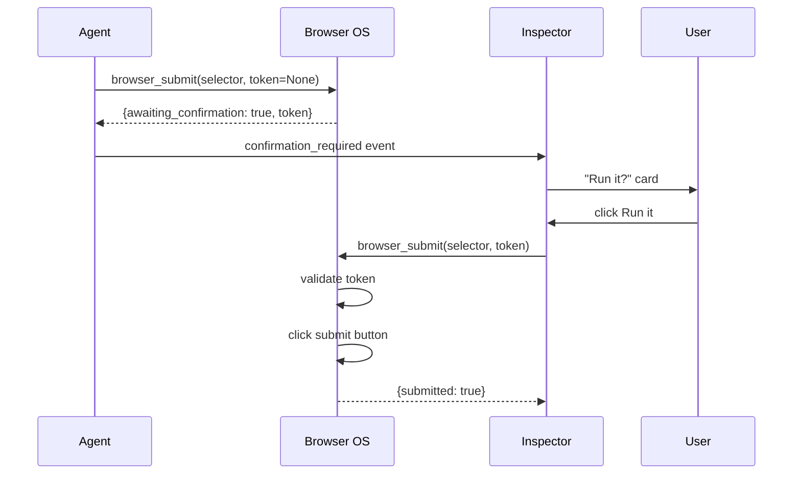

# Browser OS — Alex's sandboxed browser, the user-facing shell

The Browser OS is the user-facing shell of Alex 2.0 and the agent's
sandboxed browser.  The two are the **same** Chromium instance: the
user sees a window-manager desktop, the agent sees an
iframe-streamed view of the same DOM, and a shared control state
(who has the wheel: the agent or the user) is enforced by the
:class:`agent.browser_os.BrowserOS` backend.

## Top-level layout

```
┌─────────────────────────────────────────────────────────────┐
│  Omnibar:  [Alex]  [ URL bar for active tab ]  [ Agent cmd ]│
├─────────────────────────────────────────────────────────────┤
│  Tab strip:  [ + ]  [tab1]  [tab2]  [tab3]                   │
├──────────────────────────────────┬──────────────────────────┤
│  Floating windows:                │  Agent Inspector (always │
│    - Chat                         │  on)                     │
│    - Browser tab (iframe)         │  - text/reasoning/tool/  │
│    - Inbox / Tasks / Files /      │    law_block events      │
│      Briefs / Skills / Transparency│  - confirm / cancel      │
│    - (drag from title, resize SE) │  - count                  │
├──────────────────────────────────┴──────────────────────────┤
│  Taskbar:  [Ready/Thinking/Blocked/Confirm]   📜 9 articles  │
└─────────────────────────────────────────────────────────────┘
```

Every UI control is keyboard-accessible.  The active tab's title is
in the omnibar placeholder; the user command field at the right of
the omnibar always routes to the agent (and opens / focuses the
Chat window).

## Browser tool surface

The agent drives the browser through nine operations, all of which
go through the constitution layer:

| Operation | Capability | Notes |
|---|---|---|
| `browser_navigate` | `browser.use` | Two-phase: A8 if the URL is destructive |
| `browser_click` | `browser.act` | Refuses `mailto:` and `tel:` links |
| `browser_type` | `browser.act` | Stages form values; never submits |
| `browser_extract` | `browser.read` | Returns PII-redacted text + form state |
| `browser_screenshot` | `browser.read` | Returns `{"placeholder": "..."}` in dev |
| `browser_submit` | `browser.act` | **Two-phase (A8)**: emits `confirmation_required` first |
| `browser_list_tabs` | `browser.read` | |
| `browser_close_tab` | `browser.use` | |
| `browser_open_in_user_session` | `browser.use` | `read` / `co-drive` / `yield` |

These operations are defined in `agent/agentic_browser.py` and
registered as :class:`agent.omnigent.FunctionTool` entries in
`agent/browser_tools.py`.  The same scope tokens resolve through
:mod:`agent.guardrails` so the dual-ACL view/table fallback sees
them.

## Two-phase externalization (constitution A8)

`browser_submit` does **not** navigate to the form's `action`.  It
emits a `confirmation_required` SSE event and returns
`{"awaiting_confirmation": true, "confirmation_token": ...}`.
The agent's caller surfaces a "Run it" card in the Agent Inspector.
When the user clicks it, the route is hit with the
`confirmation_token`; the browser tool re-validates the token and
*then* performs the navigation.



## No `mailto:` / `tel:` (operational guard on top of A8)

`browser_click` rejects `mailto:` and `tel:` URLs as
`PermissionError`.  Rationale: the agent must not be able to
auto-send email or auto-dial numbers on the user's behalf; the
user can still send email through the `compose` tool (which is
a separate A1-gated flow).

## User control hand-back (co-drive)

The Agent Inspector's "Take wheel" button calls
`browser_open_in_user_session(mode="co-drive")`.  This sets
`agent_piloting = false` on the tab.  All agent operations on the
tab now raise `PermissionError` until the user clicks
"Yield to agent" (mode = `yield`).

`read` mode is the default: the user can see the tab but the agent
still has the wheel.  The tab strip draws dashed amber borders
when `agent_piloting = false` and shows a 👤 instead of 🤖 in the
tab icon.

## Constitution interceptor (L2)

Every browser operation is registered as a `FunctionTool` in the
agent's :class:`AgentDef`.  The
:mod:`agent.omnigent._alex_bridge` `ConstitutionPolicy` wraps
:mod:`agent.constitution.ConstitutionalInterceptor.check` and
emits a `law_block` SSE event on `ConstitutionalBlock`.  The
session-scoped article list lives in
`media.control.constitution`; the active article count is shown
in the taskbar (the 📜 chip).

## PII redaction (A7)

`browser_extract` runs :func:`agent.browser_os._redact_pii` over
the page text before returning.  In dev this is a regex over
emails, phone numbers, and SSN shapes.  In production the
Databricks Volume profile directory is mounted read-only into
the Chromium sandbox and `agent/browser_os_playwright.py` runs
Presidio / Comprehend for entity-level redaction.

The Agent Inspector shows "PII redacted" in the extract card
header when the redaction changed the returned text.

## Audit logging (A3)

Every browser operation appends a row to
`media.alex.agent_actions` through `_audit()` in
`agent/agentic_browser.py`.  The row carries the tool name, the
caller's user email, the session id, the input JSON, and the
outcome string.  The `browser_history` appendOnly ledger captures
the per-tab URL transitions.

## Bundle integration

* `databricks.yml` declares a `media.ops.browser_profiles`
  Unity Catalog Volume mounted by the Databricks App
  (the volume is referenced as a `resources:` entry on
  `apps.alex_app`).
* `browser_pool_warm` job keeps N warm Chromium containers
  available (5-minute schedule).
* `browser_audit` job ships the prior 24h of
  `media.control.browser_history` to the Lakehouse nightly and
  writes per-user risk signals to
  `media.control.risk_signals` (appendOnly).

## API surface

| Method | Path | Body | Returns |
|---|---|---|---|
| GET | `/api/browser/sessions` | – | `{sessions: [...]}` |
| POST | `/api/browser/sessions` | – | `{session_id}` |
| DELETE | `/api/browser/sessions/{sid}` | – | `{ok}` |
| GET | `/api/browser/sessions/{sid}/tabs` | – | `{tabs: [...]}` |
| POST | `/api/browser/sessions/{sid}/tabs?url=…` | – | `{tab_id, url, title, last_status}` |
| DELETE | `/api/browser/sessions/{sid}/tabs/{tid}` | – | `{ok}` |
| POST | `/api/browser/sessions/{sid}/tabs/{tid}/navigate` | `{url}` | `{ok, url, title, status}` |
| POST | `/api/browser/sessions/{sid}/tabs/{tid}/click` | `{selector}` | `{ok, url, title}` |
| POST | `/api/browser/sessions/{sid}/tabs/{tid}/type` | `{selector, text}` | `{ok, form_keys}` |
| POST | `/api/browser/sessions/{sid}/tabs/{tid}/extract` | `{selector}` | `{text, form, pii_redacted, ...}` |
| POST | `/api/browser/sessions/{sid}/tabs/{tid}/screenshot` | – | `{placeholder / png}` |
| POST | `/api/browser/sessions/{sid}/tabs/{tid}/submit` | `{selector, confirmation_token?}` | `{awaiting_confirmation, confirmation_token, submitted}` |
| POST | `/api/browser/sessions/{sid}/tabs/{tid}/mirror` | `{mode: read|co-drive|yield}` | `{agent_piloting, mode}` |
| GET | `/api/browser/sessions/{sid}/stream` | – | SSE stream of agent events |

All routes are OBO-scoped (the user's identity is the only
identity that can act on their browser sessions).

## Dev vs production

| Concern | Dev | Production |
|---|---|---|
| Backend | `InMemoryBrowserOS` (HTML-as-string) | `PlaywrightBrowserOS` (real Chromium) |
| Profile dir | In-process | `Volumes/media/ops/browser_profiles/<user>/<session>` |
| PII redaction | Regex | Presidio / Comprehand entity-level |
| Screenshot | Placeholder dict | PNG bytes → `data:image/png;base64,…` |
| Sandbox | None (single-process) | `--single-process` only in dev, `--no-sandbox` never in prod; the Databricks App Compute policy enforces single-user |

The dev backend is registered on
`alex.testing.Fakes.browser_os`; the production backend is
loaded lazily by `agent.browser_os.make_production_browser_os()`.

## Tests

* `tests/test_browser_os.py` — 11 tests on the
  `InMemoryBrowserOS` backend (sessions, navigate, click,
  type, extract with PII redaction, mailto refusal, user
  control, two-phase submit, history export, close).
* `tests/test_browser_os_constitution.py` — 8 tests on the
  constitution seam: tool-event emission, audit log,
  confirmation_required, two-phase token validation,
  user-control blocking, PII redaction in extract.
* `tests/test_browser_os_routes.py` — 9 FastAPI route tests
  (OBO enforcement, navigate, click mailto, two-phase submit,
  mirror, extract with PII, unauthenticated 401).
* `app/frontend/src/__tests__/desktop.test.jsx` — 13 vitest
  tests on the Browser OS shell (Window, Omnibar, TabStrip,
  AgentInspector).
